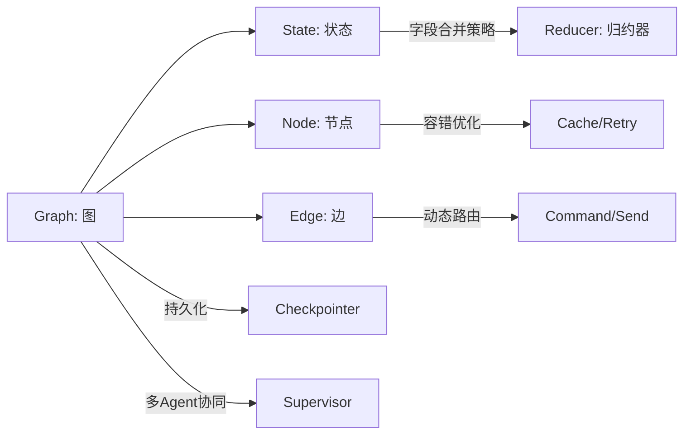
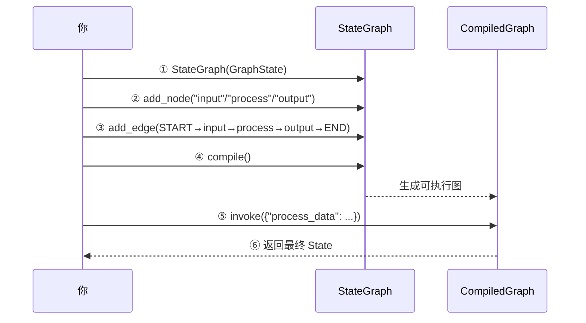
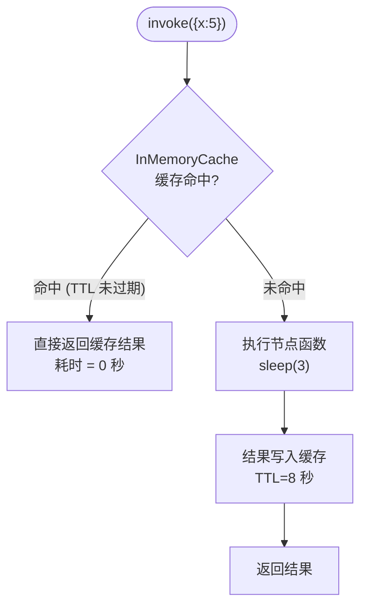
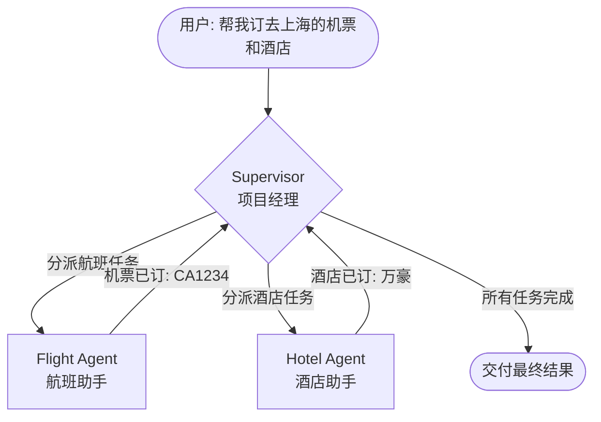

# LangGraph 课程总结：从 Hello World 到多智能体系统

## 这篇文章怎么用

这门课结束了，但我知道你们的感觉——"上个星期写的图今天已经看不懂了"。很正常，LangGraph 的概念不算少，API 又多，不反复翻看确实容易忘。

所以这篇文章是给你每天花 10 分钟通读用的。它不是那种「看完就扔」的教程，而是「随时翻出来回忆」的速查手册。每个章节我都留了大段的讲解，不是干巴巴的列 API，而是把"为什么这么设计""这件事背后的动机是什么"写清楚了。配了 mermaid 图辅助理解节点间的流转关系。

建议用法：每天早上或者开始写代码之前，花 5-10 分钟读一个章节。不要求记住每个参数，重点是把「这张图长什么样」「数据怎么流动」印在脑子里。

---

## 快速术语表

在往下读之前，先把几个核心词搞清楚。LangGraph 大量用这些术语，后面每一章都在谈它们：

| 术语 | 一句话解释 |
|------|-----------|
| **Graph（图）** | 由节点和边组成的完整流水线，LangGraph 的核心概念 |
| **State（状态）** | 图里所有节点共享的字典，数据在节点间通过它传递 |
| **Node（节点）** | 一个 Python 函数或 LLM 调用，负责处理数据 |
| **Edge（边）** | 节点之间的连接线，决定数据下一步去哪 |
| **Reducer（归约器）** | 控制 State 字段如何合并的规则：覆盖还是追加 |
| **Checkpointer（检查点）** | 自动给每一步打快照，实现对话记忆和断点续传 |
| **Multi-Agent（多智能体）** | 多个 AI 各司其职、组团干活 |



---

## 第一章：01_helloworld — 第一个 LangGraph 程序

### 1.1 这章讲了什么

第一章是入门，用三个从简到繁的例子让你跑通 LangGraph 的基本流程。三个例子分别是：纯 Python 字符串拼接、LLM 对话、无 LLM 的纯计算工作流。

核心就一件事：**让数据在节点之间流动**。你定义一个 State（数据盒子），往里面放几个节点（干活的工人），用边（传送带）把它们连起来，编译运行。完事。

LangGraph 跟普通的 LangChain 链式调用最大的区别在哪儿？普通链式调用是**单向一次性**的——输入进去，走一圈出来，结束。LangGraph 的图可以**循环**，节点之间可以来回跳，可以有条件分支，可以从中间恢复。这意味着你能用它做 Agent 那种「想一步、做一步、检查一步、可能回头再想一步」的复杂逻辑。

### 1.2 三个示例

| 文件 | 做什么 | State 类型 | 有没有 LLM |
|------|--------|------------|-----------|
| `LangGraphBiz.py` | 纯计算：x+1 再 x-2 | `dict` | 无 |
| `LangGraphHello.py` | 字符串拼接：问候语 + emoji | `TypedDict` | 无 |
| `LangGraphLLM.py` | LLM 对话：发消息，模型回复 | `TypedDict` + `add_messages` | 通义千问 |

三个文件的难度递增：

1. `LangGraphBiz.py` 最简——State 就是个普通 dict，节点是普通函数，两个节点顺序跑完。
2. `LangGraphHello.py` 用 `TypedDict` 规范了 State 的结构，IDE 有自动补全。
3. `LangGraphLLM.py` 引入了 `add_messages` reducer——这是 LangGraph 最常用的模式之一，让消息自动追加而不是覆盖。

### 1.3 本章涉及的所有 API

#### `StateGraph(schema)`

来自 `langgraph.graph`。创建图构建器。

| 参数 | 类型 | 说明 |
|------|------|------|
| `state_schema` | `TypedDict` 或 `dict` | 定义 State 的结构。传 TypedDict 有类型提示，传 dict 更灵活。所有节点共享这个 State |

#### `StateGraph.add_node(node, action)`

注册一个节点。

| 参数 | 类型 | 说明 |
|------|------|------|
| `node` | `str` | 节点的唯一名字，后续 add_edge 用它引用 |
| `action` | `Callable` | 节点函数，签名 `(state) -> dict`。返回的 dict 会被**浅合并**到当前 State |

#### `StateGraph.add_edge(start, end)`

添加一条无条件边。

| 参数 | 类型 | 说明 |
|------|------|------|
| `start` | `str` 或 `START` | 源节点名，或用 START 表示图入口 |
| `end` | `str` 或 `END` | 目标节点名，或用 END 表示图出口 |

#### `StateGraph.compile()`

编译图。无参数。返回 `CompiledGraph` 对象。编译时会校验——如果你加了一条边但忘了加对应的节点，这里会报错。

#### `CompiledGraph.invoke(input)`

执行图。

| 参数 | 类型 | 说明 |
|------|------|------|
| `input` | `dict` | 初始 State 字典。可以只传部分字段，未传的字段用默认值或之前节点的返回值填充 |

#### `CompiledGraph.get_graph()`

获取图结构对象，用于可视化。返回的对象有以下方法：

| 方法 | 参数 | 说明 |
|------|------|------|
| `.print_ascii()` | 无 | 打印 ASCII 字符画，快速看图的节点和边 |
| `.draw_mermaid()` | 无 | 输出 Mermaid 语法字符串，粘贴到 ProcessOn 或 Mermaid Live Editor 渲染 |
| `.draw_mermaid_png()` | `max_retries=2`, `retry_delay=2.0` | 通过 mermaid.ink 生成 PNG 图片（需要网络） |

#### `add_messages`

来自 `langgraph.graph.message`。消息专用的 Reducer 函数。用法：

```python
from langgraph.graph.message import add_messages

class State(TypedDict):
    messages: Annotated[List, add_messages]
```

当节点返回 `{"messages": [新消息]}` 时，`add_messages` 不会覆盖旧消息列表，而是把新消息**追加**进去。它还能自动处理消息 ID 去重、以及把纯字符串自动包装成 `HumanMessage`。

### 1.4 数据流动图

```mermaid
flowchart LR
    START -->| invoke({"name":"z3"}) | greet[greet 节点<br/>返回 {'greeting':'你好,z3'}]
    greet --> add_emoji[add_emoji 节点<br/>追加 😄]
    add_emoji --> END
    
    subgraph State 变化
        S1["{name:'z3'}"] --> |greet| S2["{name:'z3', greeting:'你好,z3'}"]
        S2 --> |add_emoji| S3["{name:'z3', greeting:'你好,z3 😄'}"]
    end
```

### 1.5 重点概念

**节点返回的是增量，不是全量。** 节点函数只返回你想修改的字段，LangGraph 自动把返回值浅合并到全局 State。这意味着你不需要在节点里把整个 State 读出来、改一个字段、再完整写回去——只返回变化的部分就行。

**浅合并的代价：嵌套 dict 要小心。** 如果你的 State 里有个字段是 dict（比如 `process_data: dict`），节点返回的 `{"process_data": {"new_key": 1}}` 会把整个 `process_data` **替换掉**，旧数据全丢。需要深度合并的话，要么在节点函数里手动处理，要么用自定义 Reducer。

**START 和 END 是两个 sentinel 常量。** 可以从 `langgraph.graph` 或 `langgraph.constants` 导入，效果一样。它们就是图入口和出口的标记。

---

## 第二章：02_graph — 图的标准构建流程

### 2.1 这章讲了什么

就一个文件 `BuildWholeGraphSummary.py`，但它把 LangGraph 建图的标准流程梳理清楚了。我们叫它「建图六步法」：

```
初始化 StateGraph → 加节点 → 加边 → 连 START/END → 编译 → 执行
```

这套流程在后面每一章都会出现。把这个流程记住，后面不管多复杂的图，本质都是这六步的变体。

这章还展示了一个重要的坑：**嵌套 dict 在 State 里怎么被覆盖的**。三个节点 `input→process→output`，`input` 设 `process_data = {"input": "input_value"}`，`process` 覆盖为 `{"process": "process_value9527"}`——原来的 `"input"` 键没了。这就是浅合并的直接后果。

### 2.2 建图六步法的时序



### 2.3 补充 API

这章没有引入新 API，但有个调试技巧值得提：

| 属性 | 说明 |
|------|------|
| `graph.edges` | 在 compile() 之前访问，查看图里所有边 |
| `graph.nodes` | 在 compile() 之前访问，查看图里所有节点 |

这两个属性在调试复杂图时非常有用——你可以在编译前检查图结构对不对，不用等到 invoke 报错才发现某个节点忘了加。

---

## 第三章：03_state — State 定义与 Reducer 归约机制

### 3.1 这章讲了什么

这是 LangGraph 最核心的一章。State 不只是个字典——**你怎么定义 State 里每个字段的合并规则，直接决定了图的行为**。LangGraph 提供了两套 State 定义方式（TypedDict 和 Pydantic），以及一套 Reducer 机制来控制字段如何更新。

这章我拆成了几个重点来聊：默认覆盖、`operator.add` 的各种形态、`add_messages`、自定义 Reducer、乘法陷阱、Schema 分离。

### 3.2 知识点详解

#### 3.2.1 默认 Reducer：覆盖

没有任何 Reducer 时，LangGraph 对 State 字段的处理是**浅合并覆盖**。节点返回了某个字段，就替换它；没返回，就保留原值。

```python
class State(TypedDict):
    foo: int
    bar: list

# node1 返回 {"foo": 22}，bar 保持原值
# node2 返回 {"bar": [1,2,3]}，foo 保持 22
```

这种模式适合「每个节点都全权负责自己的字段」的场景，比如一个字段只被一个节点修改。

#### 3.2.2 operator.add：灵活的多面手

Python 的 `operator.add` 在 LangGraph 里是个多面手——不同类型，不同行为：

| State 字段类型 | operator.add 的行为 | 示例效果 |
|---------------|-------------------|---------|
| `Annotated[list, operator.add]` | 列表拼接 `[a] + [b]` | `[0] + [1,2] + [3,4] = [0,1,2,3,4]` |
| `Annotated[str, operator.add]` | 字符串连接 `"a" + "b"` | `"Hi" + "Hello" = "HiHello"` |
| `Annotated[int, operator.add]` | 数值相加 `a + b` | `10 + 5 + 3 = 18` |

这其实是 Python 鸭子类型的体现——`operator.add` 本质就是个 `+` 号，具体怎么"加"看操作数的类型。用的时候要注意：如果你想要的是"追加"，确保字段类型是 list；如果你想要的是"连接"，字段类型就得是 str。

#### 3.2.3 add_messages：消息专用的 Reducer

来自 `langgraph.graph.message`。这是聊天机器人最常用的 Reducer，专门为消息列表设计：

```python
messages: Annotated[List, add_messages]
```

`add_messages` 做了三件事：
1. 把新消息**追加**到旧消息列表（不是覆盖）
2. 如果同 ID 的消息已存在，用新消息**更新**旧消息（去重）
3. 自动把 `("assistant", "Hello")` 这样的元组或 `{"role": "user", "content": "Hi"}` 这样的 dict 转换成 LangChain 消息对象

#### 3.2.4 乘法陷阱

这是一个经典的反面教材。如果你写了：

```python
factor: Annotated[float, operator.mul]
```

然后 `invoke({"factor": 5.0})`，期望结果是 `5.0 * 2.0 = 10.0`，但实际结果是 `0.0`。

怎么回事？因为 LangGraph 在第一个节点执行之前，会用类型的默认值初始化 State——`float` 的默认值是 `0.0`。然后它默认调用一次 Reducer：`0.0 * 5.0 = 0.0`。所以你传入的 `5.0` 还没等节点处理就已经被清零了。

加法的默认值是 `0`，`0 + 5 = 5`，不影响；但乘法的恒等元是 `1`，默认值却是 `0`，这就坏了。

#### 3.2.5 自定义 Reducer

解决方案就是自己写 Reducer：

```python
def my_mul(current: float, update: float) -> float:
    if current == 0.0:  # 检测到初始默认值
        return 1.0 * update  # 用乘法恒等元 1
    return current * update

factor: Annotated[float, my_mul]
```

自定义 Reducer 的签名是 `(current_value, new_value) -> merged_value`。任何复杂的合并逻辑都可以塞进去。注释里说得对：**复杂的业务逻辑都应该用自定义 Reducer**。

#### 3.2.6 Schema 分离：输入/输出接口

`StateSchema.py` 展示了怎么把「对外的接口」和「内部的状态」分开：

```python
class InputState(TypedDict):
    question: str          # 调用者只需要提供 question

class OutputState(TypedDict):
    answer: str            # 返回结果只包含 answer

class OverallState(InputState, OutputState):
    # 内部完整的 State，可能还有 process_data 等私有字段
    ...
```

然后创建图时这样写：

```python
graph = StateGraph(
    state_schema=OverallState,    # 内部完整状态
    input_schema=InputState,      # 对外暴露的输入
    output_schema=OutputState     # 对外暴露的输出
)
```

好处很明显：调用方只需要知道 InputState 和 OutputState，内部实现细节（临时变量、中间结果）全部封装起来。这个模式在生产级项目中非常实用。

### 3.3 本章所有 API

#### Reducer 相关

| API / 用法 | 来源 | 参数 | 说明 |
|-----------|------|------|------|
| `Annotated[Type, reducer]` | `typing` | `Type`: 字段类型；`reducer`: 合并函数 | 给 State 字段绑定 Reducer，控制合并策略 |
| `operator.add` | `operator` | 无（作为 Reducer 传入） | 通用累加 Reducer。list 拼接、str 连接、int 求和 |
| `operator.mul` | `operator` | 无（作为 Reducer 传入） | 乘法 Reducer。**注意默认值陷阱** |
| `add_messages` | `langgraph.graph.message` | 无（作为 Reducer 传入） | 消息专用 Reducer，自动追加+去重+类型转换 |
| `MyReducer(current, update)` | 自定义 | `current`: 当前值；`update`: 新值 | 自定义 Reducer 函数，返回合并后的值 |

#### StateGraph 高级参数

| API | 参数 | 说明 |
|-----|------|------|
| `StateGraph(state_schema, input_schema=None, output_schema=None)` | `state_schema`: 完整 State 类型；`input_schema`: 对外输入接口；`output_schema`: 对外输出接口 | 支持 Schema 分离的图创建 |

### 3.4 Reducer 行为对比

```mermaid
flowchart TD
    subgraph 默认覆盖
        A1["old: ['Hi']"] -->|返回 ['Hello']| A2["new: ['Hello']"]
    end
    
    subgraph operator.add 追加
        B1["old: ['Hi']"] -->|返回 ['Hello']| BR["Reducer: x+y"]
        BR --> B2["new: ['Hi','Hello']"]
    end
    
    subgraph add_messages
        C1["old: [HumanMsg]"] -->|返回 [AIMsg]| CR["Reducer: 追加+去重"]
        CR --> C2["new: [HumanMsg, AIMsg]"]
    end
    
    subgraph 自定义 Reducer
        D1["old: 0.0"] -->|传入 5.0| DR["Reducer: 检测默认值"]
        DR --> D2["new: 5.0  # 而不是 0.0"]
    end
```

---

## 第四章：04_node — 节点的高级配置

### 4.1 这章讲了什么

节点不只是一个普通函数。LangGraph 允许你给节点附加企业级的策略：**缓存**（避免重复计算）、**重试**（应对 API 不稳定）、**参数绑定**（一次性注入依赖）。这一章就是教你怎么把这些策略叠上去。

三个文件各有侧重：

| 文件 | 核心概念 |
|------|---------|
| `DefNode.py` | 基本节点定义 + `functools.partial` 参数绑定 + `RetryPolicy` |
| `Node_Cache.py` | `CachePolicy` 缓存策略 + `InMemoryCache` |
| `Node_ExpErrRetry.py` | 完整重试策略：默认/自定义/不可重试异常 |

### 4.2 知识点详解

#### 4.2.1 带参数的节点函数

有时候你的节点函数需要额外的依赖（数据库连接、配置、某个常量）。直接传会被 LangGraph 报错——因为节点函数必须只接收 `state` 一个参数。这时候用 `functools.partial` 预绑定：

```python
from functools import partial

def process_node(state, param1, param2):
    # param1 和 param2 在绑定时就固定了
    ...

graph.add_node("process", partial(process_node, param1=100, param2="test"))
```

#### 4.2.2 缓存策略

对于计算成本高且结果不常变的节点（比如大模型调用、复杂数据分析），开缓存能大幅减少重复计算。

`CachePolicy` 有两个层级：
1. **节点级**：`add_node(..., cache_policy=CachePolicy(ttl=8))`——给单个节点配 TTL
2. **图级**：`compile(cache=InMemoryCache())`——指定缓存后端

缓存的键由节点输入自动生成，不需要你手动写 key_fn。TTL 过期后缓存失效，相同输入会重新计算。

体验效果：第一次调用 sleep(3) 很慢，8 秒内第二次调用瞬间返回，超过 8 秒后又需要 3 秒。

#### 4.2.3 重试策略

网络抖一下、LLM API 偶尔 503，都是家常便饭。`RetryPolicy` 就是自动重试的保护伞。

`RetryPolicy` 的完整参数：

| 参数 | 类型 | 默认 | 说明 |
|------|------|------|------|
| `max_attempts` | `int` | 必传 | 最大尝试次数（含首次）。设为 3 表示最多重试 2 次 |
| `initial_interval` | `float` | — | 第一次重试前等待的秒数 |
| `backoff_factor` | `float` | — | 退避乘数。第 n 次间隔 = `initial * backoff^(n-1)` |
| `jitter` | `bool` | — | 加随机抖动，防止一群客户端同时重试挤爆服务 |
| `retry_on` | `Callable` 或 `tuple` | `default_retry_on` | 指定哪些异常要重试。传一个 `(Exception) -> bool` 的函数或异常类型元组 |

**默认不重试的异常**：`ValueError`, `TypeError`, `ArithmeticError`, `ImportError`, `LookupError`, `NameError`, `SyntaxError`, `RuntimeError`, `ReferenceError`, `StopIteration`, `StopAsyncIteration`, `OSError`。这些被认为是编程错误，重试没意义。

**自定义重试条件**：

```python
def custom_retry_on(exception: Exception) -> bool:
    return "模拟API调用失败" in str(exception)

RetryPolicy(max_attempts=5, retry_on=custom_retry_on)
```

只在异常消息包含特定文本时才重试，精细控制。

### 4.3 本章所有新 API

| API | 来源 | 参数 | 说明 |
|-----|------|------|------|
| `RetryPolicy(max_attempts, initial_interval, jitter, backoff_factor, retry_on)` | `langgraph.types` | 见上表 | 节点重试策略 |
| `CachePolicy(ttl)` | `langgraph.types` | `ttl`: 缓存生存时间（秒） | 节点缓存策略 |
| `InMemoryCache()` | `langgraph.cache.memory` | 无 | 内存缓存后端 |
| `add_node(name, action, retry=None, cache_policy=None)` | `StateGraph` | `retry`: RetryPolicy；`cache_policy`: CachePolicy | 新版 add_node 支持策略参数 |
| `compile(cache=None)` | `StateGraph` | `cache`: 缓存后端实例 | 编译时指定缓存后端 |
| `set_entry_point(node)` | `StateGraph` | `node`: 节点名 str | `add_edge(START, node)` 的语法糖 |
| `set_finish_point(node)` | `StateGraph` | `node`: 节点名 str | `add_edge(node, END)` 的语法糖 |

### 4.4 缓存流程



---

## 第五章：05_edge — 固定边与条件路由

### 5.1 这章讲了什么

前面几章的图都是线性的——一条路走到底。实际业务里哪有这么简单？你得根据数据内容决定下一步去哪。这一章就是教你怎么"分叉"。

五种边的情况：

| 文件 | 核心概念 |
|------|---------|
| `Edge_Normal.py` | 普通边：无条件，固定流向 |
| `Edge_Conditional.py` | 条件边：根据 State 值选节点，Pydantic 做 State |
| `Edge_ConditionalEntryPoint.py` | 条件入口：从 START 就开始分叉 |
| `Edge_ConditionalV2.py` | 条件入口简版 |
| `Edge_EntryPoint.py` | `set_entry_point` / `set_finish_point` 语法糖 |

### 5.2 条件边的核心机制

条件边通过 `add_conditional_edges` 实现，三要素：

1. **source**：从哪个节点出发
2. **路由函数（path）**：接收 State，返回一个路由键（字符串、布尔值，啥都行）
3. **映射字典（path_map）**：把路由键映射到实际节点名

```python
def route(state) -> bool:
    return state.x % 2 == 0

builder.add_conditional_edges(
    source="check",
    path=route,
    path_map={True: "handle_even", False: "handle_odd"}
)
```

路由键不限于布尔值——字符串、数字都可以，只要能在 `path_map` 里找到对应。

### 5.3 Pydantic 做 State

`Edge_Conditional.py` 用 Pydantic BaseModel 定义了 State，而不是 TypedDict：

```python
from pydantic import BaseModel

class MyState(BaseModel):
    x: int
    result: Optional[str] = None
```

两种方式 LangGraph 都支持。Pydantic 的好处是带验证，TypedDict 的好处是更轻量。选哪个看你项目规范。

### 5.4 条件入口点

`add_conditional_edges(START, ...)` 允许从图的入口就开始分叉——根据输入数据决定第一个执行的节点。这种模式在做「消息路由」时特别有用：用户发个"你好"走问候节点，发"再见"走告别节点。

### 5.5 本章所有新 API

| API | 来源 | 参数 | 说明 |
|-----|------|------|------|
| `add_conditional_edges(source, path, path_map)` | `StateGraph` | `source`: 源节点或 START；`path`: 路由函数 `(state) -> key`；`path_map`: `{key: node_name}` 映射词典 | 添加条件边 |
| `set_entry_point(node)` | `StateGraph` | `node`: 节点名 | 设置入口节点，语法糖 |
| `set_finish_point(node)` | `StateGraph` | `node`: 节点名 | 设置出口节点，语法糖 |

### 5.6 条件路由流程

```mermaid
flowchart TD
    START --> check[check_x 节点]
    check --> Router{is_even(state.x)}

    Router -->|"True (偶数)"| handle_even[handle_even 节点<br/>处理偶数逻辑]
    Router -->|"False (奇数)"| handle_odd[handle_odd 节点<br/>处理奇数逻辑]

    handle_even --> END
    handle_odd --> END
```

---

## 第六章：06_specialApi — Command 与 Send 动态流转

### 6.1 这章讲了什么

第五章的条件边是声明式的——你提前定义好路由规则，LangGraph 帮你执行。而 `Command` 和 `Send` 是命令式的——**节点自己决定下一步去哪**。这俩 API 是 LangGraph 1.0 的精髓，也是构建多 Agent 系统的底层基础设施。

三个文件：

| 文件 | 核心概念 |
|------|---------|
| `RuntimeContextDemo.py` | RuntimeContext：把配置和依赖从 State 里拆出来 |
| `SendDemo.py` | Send + Map-Reduce：动态并行任务分发 |
| `CommandDemo.py` | Command：节点同时更新状态和控制跳转 |

### 6.2 Runtime Context：State 里别塞配置

有个常见的错误——把所有东西都扔进 State：用户消息、LLM 回复、模型名称、API Key、数据库连接字符串。State 应该装的是「工作流数据」，配置/依赖应该走 Context。

```python
from dataclasses import dataclass
from langgraph.runtime import Runtime

@dataclass
class ContextSchema:
    model_name: str
    db_connection: str
    api_key: str

class AgentState(TypedDict):
    messages: Annotated[list, lambda x, y: x + y]
    response: str

graph = StateGraph(AgentState, context_schema=ContextSchema)

def process_message(state: AgentState, runtime: Runtime[ContextSchema]):
    # 通过 runtime.context 拿配置
    print(f"当前模型: {runtime.context.model_name}")
    ...

# 执行时注入
context = ContextSchema(model_name="qwen-plus", ...)
graph.invoke({...}, context=context)
```

节点函数签名从 `(state)` 变成了 `(state, runtime)`。`runtime.context` 里拿到的就是你在 invoke 时传入的 ContextSchema 实例。

### 6.3 Send：动态并行分发

`Send` 实现了经典的 Map-Reduce 模式。一个节点产出一个主题列表，然后为每个主题并行启动一个处理节点，最后所有结果通过 Reducer 汇总。

```python
from langgraph.types import Send

def map_to_jokes(state):
    # 每个 subject 创建一个 Send，并行执行
    return [Send("make_joke", {"subject": s}) for s in state["subjects"]]
```

配合 `add_conditional_edges` 使用（注意不需要 path_map，因为 Send 里已经包含了目标节点名）：

```python
builder.add_conditional_edges("generate", map_to_jokes)
```

关键点：**接受结果的 State 字段必须用 Reducer**（比如 `Annotated[List, operator.add]`），否则并行任务的返回结果会互相覆盖而不是汇总。

### 6.4 Command：一步到位

`Command` 把两件事合并了：状态更新 + 路由控制。以前你得在条件边里写路由函数，现在节点直接返回一个 Command 对象说"我改了哪些数据，下一个去 XX 节点"。

```python
from langgraph.types import Command

def decision_agent(state) -> Command[AgentState]:
    if state["task_completed"]:
        return Command(update={...}, goto=END)
    if "数学" in last_msg:
        return Command(update={"current_agent": "math"}, goto="math_agent")
    return Command(update={"current_agent": "translation"}, goto="translation_agent")
```

注意：即使节点用 Command 的 goto 控制跳转，图里的边还是要用 `add_edge` 定义好——add_edge 定义的是**静态拓扑**，Command 的 goto 定义的是**运行时路由**，两者不矛盾。**recursion_limit** 参数（`invoke(..., recursion_limit=50)`）防止 Command 导致的循环永不终止。

### 6.5 本章所有新 API

| API | 来源 | 参数 | 说明 |
|-----|------|------|------|
| `Runtime[T]` | `langgraph.runtime` | `T`: Context 类型 | 运行时对象类型注解，节点通过 `runtime.context` 读配置 |
| `StateGraph(schema, context_schema=ContextType)` | `langgraph.graph` | `context_schema`: 上下文类型（dataclass） | 创建带有运行时上下文的图 |
| `invoke(input, context=ctx)` | `CompiledGraph` | `context`: ContextSchema 实例 | 执行时注入上下文 |
| `invoke(input, recursion_limit=50)` | `CompiledGraph` | `recursion_limit`: 最大递归次数 | 防止 Command 循环无限执行 |
| `Send(node, data)` | `langgraph.types` | `node`: 目标节点名；`data`: 传给该节点的状态 dict | 创建一个并行任务，用于 Map-Reduce |
| `Command(update, goto)` | `langgraph.types` | `update`: 状态更新 dict；`goto`: 下一个节点名或 END | 同时完成状态更新和路由控制 |

### 6.6 Command 与 Send 的运行机制

```mermaid
flowchart TD
    subgraph Command 流程
        DA[decision_agent] -->|"Command(update, goto='math')"| MA[math_agent]
        MA -->|"Command(update, goto='decision')"| DA
        DA -->|"Command(goto=END)"| END_C[结束]
    end

    subgraph Send 并行分发
        Main[主节点: 生成主题列表] -->|Send('worker',{topic:'A'})| W1[Worker: 处理 A]
        Main -->|Send('worker',{topic:'B'})| W2[Worker: 处理 B]
        Main -->|Send('worker',{topic:'C'})| W3[Worker: 处理 C]
        W1 --> Merge[Reducer 汇总]
        W2 --> Merge
        W3 --> Merge
    end
```

---

## 第七章：07_senior — 高级特性全家桶

### 7.1 这章讲了什么

这章是 LangGraph 的进阶课，覆盖了四个核心高级特性：

1. **状态持久化**：给图打存档，支持断点续传和多会话隔离
2. **流式传输**：实时看到 LLM 的 token 输出和状态变化
3. **子图嵌套**：把一个已编译的图当作另一个图的节点
4. **时光旅行**：回到历史某个检查点，修改状态，重新执行

这四块是生产级 Agent 系统的基础设施。

### 7.2 状态持久化

#### 7.2.1 Checkpointer 机制

LangGraph 的持久化通过 Checkpointer 实现。每执行完一个节点，框架自动保存当前 State 的快照。你需要提供一个 `thread_id` 来标识会话。

```python
from langgraph.checkpoint.memory import InMemorySaver

checkpointer = InMemorySaver()
app = builder.compile(checkpointer=checkpointer)

config = {"configurable": {"thread_id": "user-001"}}
result = app.invoke({"messages": [("user", "你好")]}, config=config)
```

`thread_id` 是关键——没有它，不同用户的消息会混在一起；有了它，每个会话有自己的独立存档。

#### 7.2.2 三种持久化后端

| 后端 | 来源 | 用途 |
|------|------|------|
| `InMemorySaver()` | `langgraph.checkpoint.memory` | 开发测试用，进程关了数据就没了 |
| `SqliteSaver(conn)` | `langgraph-checkpoint-sqlite` | 轻量级生产环境，数据存本地 SQLite |
| `PostgresSaver(...)`（参考） | `langgraph-checkpoint-postgres` | 生产环境，团队共享 |

`SqliteSaver` 需要先创建 `sqlite3.connect()` 连接，设置 `check_same_thread=False`（LangGraph 运行时是多线程的）。

#### 7.2.3 查询状态和历史

```python
# 查当前状态
snapshot = app.get_state(config)
print(snapshot.values)  # 当前 State 的值
print(snapshot.next)    # 下一个要执行的节点

# 查完整历史（按时间正序）
history = list(app.get_state_history(config))
```

#### 7.2.4 Agent 持久化

`create_agent` 配合 `checkpointer`，Agent 天然拥有记忆：

```python
from langchain.agents import create_agent

agent = create_agent(model=llm, checkpointer=InMemorySaver())
agent.invoke({"messages": ["我是 Atlas"]}, config={"configurable": {"thread_id": "user-001"}})
# 第二轮，Agent 记得上一轮说过什么
agent.invoke({"messages": ["我叫什么？"]}, config={"configurable": {"thread_id": "user-001"}})
```

同一 `thread_id` 下，Agent 会保留完整对话历史。

### 7.3 流式传输

LangGraph 支持五种流模式：

| 模式 | 返回内容 | 适用场景 |
|------|---------|---------|
| `"values"` | 每个节点执行后的完整 State | 需要全量状态 |
| `"updates"` | 每个节点的增量更新 | 追踪变化 |
| `"messages"` | LLM 的 token 片段 | 打字机效果 |
| `"custom"` | 节点主动发送的自定义数据 | 进度报告、中间结果 |
| `"debug"` | 详细调试信息 | 排查问题 |

可以组合使用：

```python
for mode, chunk in app.stream(inputs, stream_mode=["updates", "custom"]):
    if mode == "updates":
        print(f"状态更新: {chunk}")
    elif mode == "custom":
        print(f"自定义数据: {chunk}")
```

#### 自定义流：get_stream_writer()

```python
from langgraph.config import get_stream_writer

def my_node(state):
    writer = get_stream_writer()
    writer({"progress": "正在处理..."})
    ...
    writer({"progress": "处理完成"})
    return {"result": "..."}
```

`get_stream_writer()` 只能在图执行上下文内调用。它返回一个可调用对象，往里面塞任意字典，客户端就能通过 `stream_mode="custom"` 收到。做进度条、日志输出非常好用。

### 7.4 子图

#### 7.4.1 直接嵌套（同构 State）

父子图使用相同的 State 类型时，直接把编译后的子图当作节点加进去：

```python
subgraph = subgraph_builder.compile()
builder.add_node("subgraph_node", subgraph)
```

注意：如果 State 用了 `operator.add` Reducer，会出现「双重合并」——子图内部合并一次，主图又合并一次。这是个容易踩的坑。

#### 7.4.2 异构 State 的代理模式

父子图 State 不同时，用代理节点手动做转换：

```python
def call_subgraph_proxy(state: ParentState):
    # 1. 父状态 → 子输入
    sub_input = {"analysis_input": state["user_query"]}
    # 2. 手动调子图
    sub_result = compiled_subgraph.invoke(sub_input)
    # 3. 子输出 → 父状态
    return {"final_answer": sub_result["analysis_result"]}
```

这种模式在实际项目里很常见——不同团队开发的 Agent 会有各自的 State 结构，代理节点就是适配层。

### 7.5 时光旅行（Time Travel）

时光旅行的核心 API 是 `update_state`。在某个历史检查点上修改状态，然后从那里分叉执行。

四步操作：

```
1. get_state_history(config)  → 获取所有历史检查点
2. 选择目标检查点
3. update_state(checkpoint.config, values={...})  → 修改该点的状态，返回新配置
4. invoke(None, new_config)  → 从新配置继续执行
```

`update_state` 创建的是**分支**，不影响原来的执行路径。类似于 git 的 branch——你从 commit #2 切出去改了点东西，这之后的执行就是一个新分支了。

### 7.6 本章所有新 API

#### 持久化相关

| API | 来源 | 参数 | 说明 |
|-----|------|------|------|
| `compile(checkpointer=...)` | `StateGraph` | `checkpointer`: InMemorySaver / SqliteSaver 实例 | 编译时挂载检查点 |
| `InMemorySaver()` | `langgraph.checkpoint.memory` | 无 | 内存检查点 |
| `SqliteSaver(conn)` | `langgraph-checkpoint-sqlite` | `conn`: sqlite3 连接 | SQLite 持久化 |
| `config = {"configurable": {"thread_id": "..."}}` | 约定 | `thread_id`: 会话标识 | 所有持久化 API 都需要它 |
| `get_state(config)` | `CompiledGraph` | `config`: 线程配置 | 获取当前状态快照 |
| `get_state_history(config)` | `CompiledGraph` | `config`: 线程配置 | 获取该线程的所有历史检查点 |
| `update_state(config, values=...)` | `CompiledGraph` | `config`: 目标检查点配置；`values`: 要修改的状态字段 | 在指定检查点修改状态，创建分支 |
| `create_agent(model, tools, checkpointer)` | `langchain.agents` | `checkpointer`: 检查点实例 | 创建带记忆的 Agent |

#### 流式相关

| API | 参数 | 说明 |
|-----|------|------|
| `stream(input, stream_mode)` | `input`: 初始状态；`stream_mode`: 模式字符串或列表 | 流式执行图 |
| `get_stream_writer()` | 无参数 | 在节点内获取流写入器 |
| `writer(data)` | `data`: 任意字典 | 发送自定义数据到流通道 |

#### 子图相关

| API | 说明 |
|-----|------|
| `add_node(name, compiled_subgraph)` | 将编译后的子图作为节点嵌入 |
| `compiled_subgraph.invoke(input)` | 在代理节点内手动调用子图 |

---

## 第八章：08_multi_agent — 多智能体协同

### 8.1 这章讲了什么

前面的所有章节都是为这一章做铺垫。多智能体系统是 LangGraph 的终极应用场景——把多个各有所长的 Agent 组织起来，协同完成用户指令。

四个文件，三个模式：

| 文件 | 模式 | 核心 API |
|------|------|---------|
| `LangGraphAgent.py` | 单 Agent | `create_agent` |
| `SupervisorV0.3.py` | 监督者模式（旧版） | `create_react_agent` + `create_supervisor` |
| `SupervisorV1.0.py` | 监督者模式（新版） | `create_agent` + `create_supervisor` |
| `SupervisorHandoff.py` | Handoff 移交模式 | `Command` + `Send` + `create_task_description_handoff_tool` |

### 8.2 单 Agent

`create_agent` 是 LangChain 提供的一站式 Agent 创建 API，替代了旧版的 `create_react_agent`：

```python
from langchain.agents import create_agent

@tool
def get_weather(city: str) -> str:
    """查询指定城市的天气。"""
    return f"{city}今天晴天，25°C"

agent = create_agent(model=llm, tools=[get_weather])
result = agent.invoke({"messages": [HumanMessage(content="北京天气怎么样？")]})
```

Agent 底层就是一个编译好的 LangGraph 图，内部已经包含了工具调用循环（LLM 输出 tool_call → 执行工具 → 回到 LLM → 最终输出）。不需要你手动搭图。

### 8.3 监督者模式（Supervisor Pattern）

如同项目组有个 PM，负责看需求、分配任务、收结果、决定要不要继续派活。

```python
from langgraph_supervisor import create_supervisor

flight_agent = create_agent(model=llm, tools=[book_flight], name="flight_assistant")
hotel_agent = create_agent(model=llm, tools=[book_hotel], name="hotel_assistant")

supervisor = create_supervisor(
    agents=[flight_agent, hotel_agent],
    model=llm,
    prompt="你是旅行助手主管。根据用户需求，分派给航班助手或酒店助手。每个助手只调用一次，完成后结束。"
)
```

`create_supervisor` 自动处理调度——接收消息、选 Agent、传递结果、判断是否结束。`prompt` 里定义调度规则。

#### v0.3 vs v1.0 的差异

v0.3 用 `create_react_agent`（已弃用，LangGraph v2.0 将移除），需要手动写子 Agent 的 prompt。v1.0 用 `create_agent`，工具 docstring 自动提供上下文，不需要手动写 prompt。

### 8.4 Handoff 移交模式

监督者模式是「中央调度」，Handoff 是「直接移交」——Agent A 干完活，直接把控制权交给 Agent B，不需要回来报告给监督者。

通过 `create_task_description_handoff_tool` 工厂函数生成移交工具：

```python
from langgraph.prebuilt.tool_node import InjectedState

@tool(name="transfer_to_hotel_assistant", description="当你需要预订酒店时将任务转交给酒店助手")
def handoff_to_hotel(
    flight_result: str,
    state: Annotated[MessagesState, InjectedState]
) -> Command:
    return Command(
        update={"messages": [("user", f"航班已预订: {flight_result}")]},
        goto=[Send("hotel_assistant", state)],
        graph=Command.PARENT
    )
```

关键在于 `Command(goto=[Send(...)], graph=Command.PARENT)`——让命令作用在父图层级，把控制权发送给另一个 Agent。

### 8.5 本章所有新 API

| API | 来源 | 参数 | 说明 |
|-----|------|------|------|
| `create_agent(model, tools, name, checkpointer)` | `langchain.agents` | `model`: LLM；`tools`: 工具列表；`name`: Agent 名；`checkpointer`: 检查点 | 新版 Agent 创建（替代 create_react_agent） |
| `create_supervisor(agents, model, prompt)` | `langgraph_supervisor` | `agents`: 子 Agent 列表；`model`: 监督者 LLM；`prompt`: 调度规则 | 创建监督者图 |
| `@tool(name, description)` | `langchain_core.tools` | `name`: 工具名；`description`: 工具描述（LLM 通过它理解工具用途） | 将函数标记为 LangChain 工具 |
| `InjectedState` | `langgraph.prebuilt.tool_node` | 无（类型注解用） | 标记参数值从图状态注入，而非 LLM 决定 |
| `Command(goto, update, graph)` | `langgraph.types` | `goto`: `Send` 列表或节点名或 END；`update`: 状态更新；`graph`: `Command.PARENT` | Handoff 模式的路由控制 |
| `Command.PARENT` | `Command` 类属性 | 常量 | 指示 Command 作用在父图层级 |
| `create_task_description_handoff_tool(model, agent_name)` | —（工厂函数） | `model`: LLM；`agent_name`: 目标 Agent 名 | 动态创建移交工具 |

### 8.6 监督者模式的执行流程



---

## 结尾：复习路线建议

LangGraph 的知识不是线性的——后面学的东西会让你对前面的理解更深。所以我建议这样复习：

**每天一章，按顺序来**：
1. 周一：第一章（Hello World）——5 分钟就行，重点是「State + Node + Edge」这个铁三角
2. 周二：第二章（建图六步法）——把六个步骤在脑子里过一遍
3. 周三：第三章（State 与 Reducer）——这是核心，多花点时间搞清楚覆盖 vs 追加
4. 周四：第四章（节点高级配置）——缓存和重试，知道在哪儿配就行
5. 周五：第五章（条件边）——路由函数怎么写
6. 周六：第六章（Command 与 Send）——LangGraph 1.0 的王牌 API
7. 周日：第七章（持久化/流式/子图/时光旅行）——内容多，分早晚各读一半
8. 下周周一：第八章（多智能体）——最后的集大成

**重点复盘的几个概念**：

1. **State 怎么流动的**——每次问自己：这个节点改了什么、下一个节点能看到什么
2. **Reducer 怎么合并的**——不是每个字段都是同一种合并方式
3. **Command vs add_conditional_edges**——声明式还是命令式，各有利弊
4. **thread_id 为什么重要**——没有它就没有多轮对话

遇到想不起来的 API，直接回这篇文章搜——每个 API 都列了参数和用途，不用再去翻代码。

这门课教的是「怎么用」LangGraph。但真正掌握，靠的是你自己搭一个图——哪怕是个最简单的用户输入→LLM→输出的两节点图，跑通一遍，比读十遍文章管用。

---

> 这篇文章不会再有「AI 味」的结尾。就一句话：去写代码吧。
