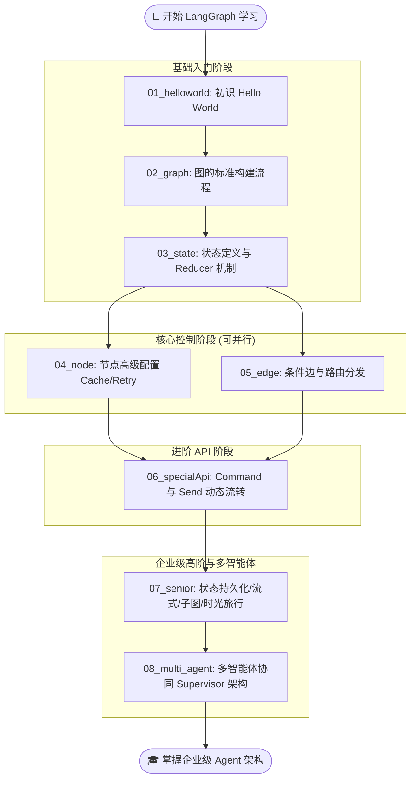
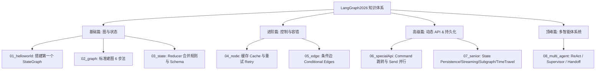
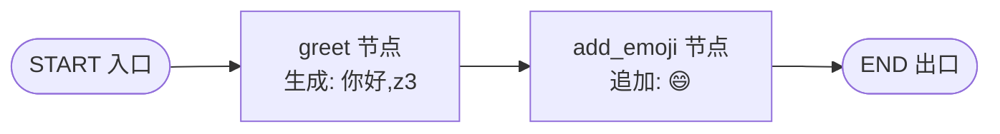
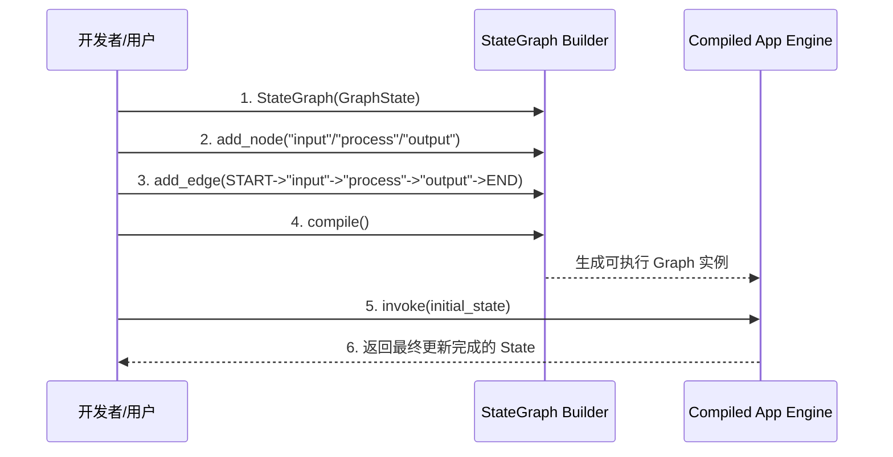
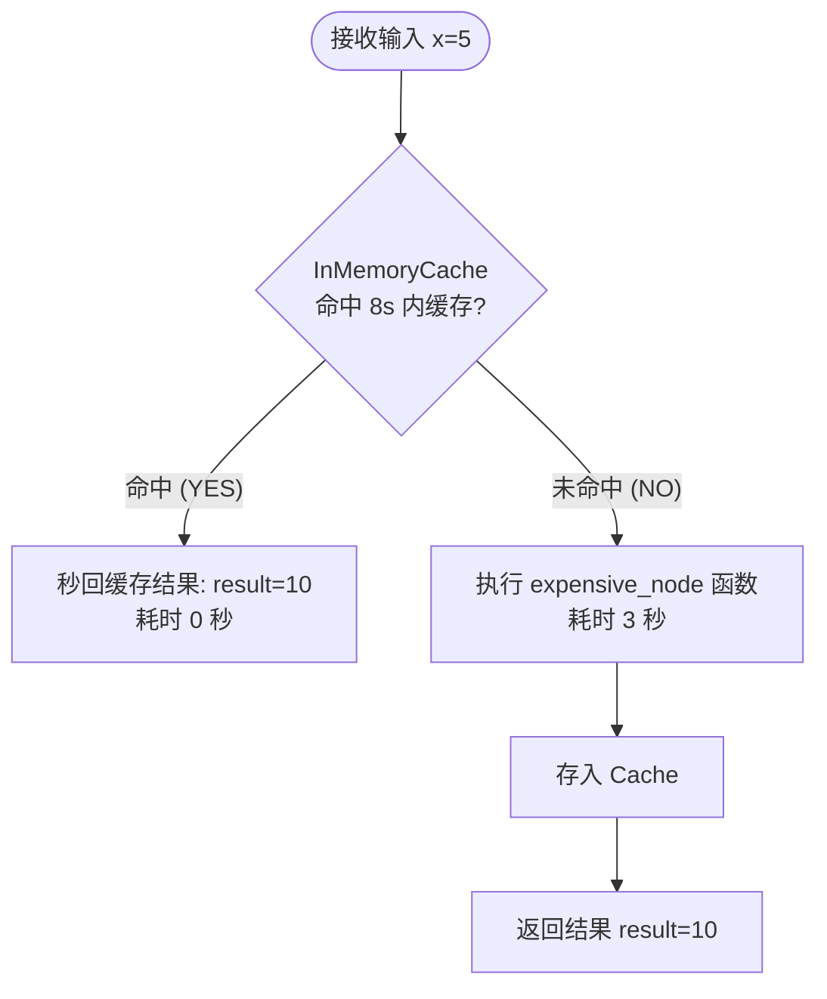
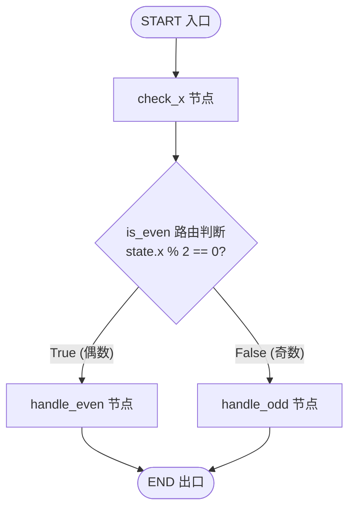
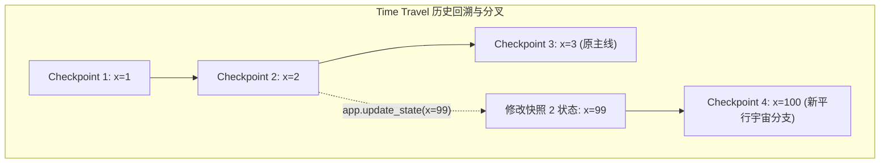

# LangGraph 2026 全景学习指南：从零打造 LLM 工作流与多智能体系统

---

## 📖 导读与新手术语小词典 (Glossary for Beginners)

欢迎来到 LangGraph 的世界！如果你熟悉 Python 基础，但从未接触过工作流引擎或大语言模型（LLM） Agent 开发，请先阅读以下**术语小词典**：

- **LangGraph**：由 LangChain 团队推出的 Python 框架，专门用于给大语言模型装上“工作流程图”和“持久记忆大脑”，实现复杂、可循环、可控的自动化 AI 系统。
- **Graph (图)**：由**节点**和**边**组成的完整自动化流水线。
- **State (状态)**：流水线上共享的“数据记分板”。所有节点都能读取它，并往上面写新数据。
- **Node (节点)**：具体的 Python 函数或大模型 API 调用，相当于流水线上负责特定工作的“工人”。
- **Edge (边)**：决定数据下一步流向哪个节点的“传送带”或“交通信号灯”。
- **Reducer (规约器)**：决定新数据写入记分板时的合并规则（例如：是擦掉旧数据直接覆盖，还是追加在列表末尾）。
- **Checkpointer (持久化/存档点)**：自动给流程打快照的“游戏存档点”，支持对话历史保存、多用户隔离与断点续传。
- **Multi-Agent (多智能体)**：多个各司其职的 AI（如程序员 AI、搜索 AI、项目经理 AI）组团协同完成复杂任务。

---

## 🗺️ 0. 整体学习路线图 (Overall Learning Roadmap)



---

## 📊 1. 总体分析与知识图谱 (Overall Knowledge Architecture)

### 1.1 项目知识体系演进 (Skill Tree Evolution)

[LangGraph2026](file:///d:/Develop/Code_Projects/ai-python/LangGraph2026) 的目录设计遵循了软件工程中“从零建立认知 -> 规范化构建 -> 细粒度控制 -> 高高级扩展 -> 系统级协同”的科学教学路径：

1. **第一阶：建图与状态基石（01_helloworld ~ 03_state）**
   - 掌握 `StateGraph` 的“声明-定义-编译-运行”生命周期。
   - 理解 Python `TypedDict` / `Pydantic` 状态在节点间的传递，以及 `Reducer` 函数如何控制数据的覆盖与追加。
2. **第二阶：控制流与容错机制（04_node ~ 05_edge）**
   - 掌握节点级别的缓存（`CachePolicy`）与故障自动重试（`RetryPolicy`）。
   - 掌握静态边（`add_edge`）与条件边（`add_conditional_edges`）路由逻辑。
3. **第三阶：LangGraph 1.0 高级控制 API（06_specialApi）**
   - 使用 `Command` 替代繁琐的条件边，实现“更新状态+指定下一节点”一步到位。
   - 使用 `Send` 实现 Map-Reduce 动态并行分发。
4. **第四阶：企业级实战与多智能体系统（07_senior ~ 08_multi_agent）**
   - 掌握持久化存档（`MemorySaver`/`SqliteSaver`）、流式响应（Streaming）、子图嵌套（Subgraph）与历史回溯（Time Travel）。
   - 最终打造出以 Supervisor 为主控中心、兼具多 Agent 分工协同的大型系统。

---

### 1.2 总体知识图谱 (Mermaid Graph)



---

## 📘 2. 分章节深度解读 (Chapter by Chapter Breakdown)

---

### 01_helloworld - 初识 LangGraph 与第一个图

#### 🎯 学习目标
- 明白 LangGraph 与普通 LangChain 链式调用的根本区别（支持循环与状态管理）。
- 学会定义一个极简的 `StateGraph`，向其中添加节点（Node）与边（Edge）。
- 掌握编译 `compile()` 和执行 `invoke()` 的标准语法，并能将图结构打印导出。

#### 💡 核心概念解读（生活化类比）
- **`StateGraph`（自动化工厂流水线）**：就像一条玩具组装流水线。你需要先预定流水线传动的盒子里放什么（`State`），然后把各个岗位的工人（`Node`）固定在流水线上，再用传送带（`Edge`）把他们连起来。
- **`START` / `END`（入口与出口）**：流水线的货物投递口（`START`）和成品下线口（`END`）。
- **`app = graph.compile()`（竣工验收）**：搭建完流水线后点击“启动检查”，确保没有挂空的传送带后，生成可运行的工厂实例 `app`。

#### 🔍 代码逻辑示意
在 [LangGraphHello.py](file:///d:/Develop/Code_Projects/ai-python/LangGraph2026/01_helloworld/LangGraphHello.py) 中：
```python
# 1. 定义状态
class HelloState(TypedDict):
    name: str
    greeting: str

# 2. 定义节点函数（每个节点接收状态，返回更新字典）
def greet(helloState: HelloState) -> dict:
    return {"greeting": f"你好,{helloState['name']}"}

def add_emoji(helloState: HelloState) -> dict:
    return {"greeting": helloState["greeting"] + "  。。。😄"}

# 3. 组装图并编译
graph = StateGraph(HelloState)
graph.add_node("greeting", greet)
graph.add_node("add_emoji", add_emoji)

graph.add_edge(START, "greeting")
graph.add_edge("greeting", "add_emoji")
graph.add_edge("add_emoji", END)

app = graph.compile()

# 4. 触发运行
result = app.invoke({"name": "z3"})
```
- **执行流程**：`START` -> `greet` 节点（生成问候语） -> `add_emoji` 节点（追加表情） -> `END`。数据在节点间传递并一步步被修饰。

#### 🎨 流程示意图


#### 🔄 与前后章衔接
- **前置依赖**：Python 基础 `TypedDict` 语法。
- **后置铺垫**：本章展示了静态线性流程，下一章 [02_graph](file:///d:/Develop/Code_Projects/ai-python/LangGraph2026/02_graph/BuildWholeGraphSummary.py) 将规范化图构建的标准步骤。

#### ❓ 思考题
1. 如果在 `graph.add_node("greeting", greet)` 后忘记写 `graph.add_edge(START, "greeting")`，运行 `app.invoke()` 会发生什么？
2. 节点函数返回的必须是完整的 `HelloState` 还是只需要返回包含更新键值的字典？

#### 🚀 推荐学习步骤
1. 打开 [LangGraphHello.py](file:///d:/Develop/Code_Projects/ai-python/LangGraph2026/01_helloworld/LangGraphHello.py)，直接运行观察终端输出。
2. 试着修改 `add_emoji` 函数，给 `greeting` 追加不同的文本。
3. 学习 [LangGraphBiz.py](file:///d:/Develop/Code_Projects/ai-python/LangGraph2026/01_helloworld/LangGraphBiz.py) 和 [LangGraphLLM.py](file:///d:/Develop/Code_Projects/ai-python/LangGraph2026/01_helloworld/LangGraphLLM.py)，体验结合真实业务逻辑与 LLM 模型的过程。

---

### 02_graph - 标准图构建生命周期与规范

#### 🎯 学习目标
- 掌握 LangGraph 中创建图的“标准 6 步法”。
- 深刻理解节点函数的输入与输出规范（输入完整状态，输出局部增量）。
- 学会使用 ASCII 和 Mermaid 工具将可视化流程图导出或打印。

#### 💡 核心概念解读（生活化类比）
- **图构建 6 步法（房屋建筑施工图）**：建房子不能随心所欲，必须按照“地基（初始化图）-> 房间（加节点）-> 走廊（加边）-> 大门（入口出口）-> 验收（编译）-> 入住（执行）”的固定步骤进行。

#### 🔍 代码逻辑示意
在 [BuildWholeGraphSummary.py](file:///d:/Develop/Code_Projects/ai-python/LangGraph2026/02_graph/BuildWholeGraphSummary.py) 中：
```python
# 步 1: 初始化 StateGraph 实例
graph = StateGraph(GraphState)

# 步 2: 添加节点
graph.add_node("input", input_node)
graph.add_node("process", process_node)
graph.add_node("output", output_node)

# 步 3 & 步 4: 定义边与连接起点终点
graph.add_edge(START, "input")
graph.add_edge("input", "process")
graph.add_edge("process", "output")
graph.add_edge("output", END)

# 步 5: 编译图
app = graph.compile()

# 步 6: 执行工作流
result = app.invoke({"process_data": {"name": "测试数据", "value": 123456}})
```
- **关键细节**：节点可以接收字典或特定的 `TypedDict` 状态。节点返回的数据会自动合并进全局状态字典中。

#### 🎨 流程示意图


#### 🔄 与前后章衔接
- **前置依赖**：[01_helloworld](file:///d:/Develop/Code_Projects/ai-python/LangGraph2026/01_helloworld/LangGraphHello.py) 的基本概念。
- **后置铺垫**：掌握了规范建图后，下一步 [03_state](file:///d:/Develop/Code_Projects/ai-python/LangGraph2026/03_state/DefState.py) 将深入探究 State 在后台到底是“怎么被更新合并的”。

#### ❓ 思考题
1. 为什么在编译 `compile()` 之前不能直接调用 `graph.invoke()`？
2. 调用 `app.get_graph().draw_mermaid()` 生成的代码可以在哪里实时渲染查看可视化结果？

#### 🚀 推荐学习步骤
1. 阅读 [BuildWholeGraphSummary.py](file:///d:/Develop/Code_Projects/ai-python/LangGraph2026/02_graph/BuildWholeGraphSummary.py) 的头部注释，记住图构建的 6 个步骤。
2. 运行代码，复制控制台打印出的 Mermaid 源码，黏贴到 ProcessOn 或 Mermaid Live Editor 查看图形。

---

### 03_state - 状态 Schema 定义与 Reducer 规约机制

#### 🎯 学习目标
- 掌握 `TypedDict` 与 `Pydantic` 定义状态（State Schema）的两种不同风格。
- 深刻理解 LangGraph 默认的状态覆盖更新机制（Overwrite）。
- 掌握 `Annotated` 与 `Reducer` 规约器（如 `operator.add`、`add_messages`），实现数据的追加合并与自定义计算。

#### 💡 核心概念解读（生活化类比）
- **State（班级黑板）**：节点是轮流上台写字的学生。
- **默认 Overwrite（黑板擦清空）**：默认情况下，下一个学生上台会把上一个人写的字擦掉，写上自己的新字。
- **Reducer（留言板追加）**：如果在黑板字段加上了 Reducer（如 `add_messages` 或 `operator.add`），就相当于规定“不准擦黑板，只能在前面文字的下方接着往下写”或者“把新数字加到旧数字上”。

#### 🔍 代码逻辑示意
在 [StateReducer_AddMessages.py](file:///d:/Develop/Code_Projects/ai-python/LangGraph2026/03_state/reducers/StateReducer_AddMessages.py) 与 [StateReducer_OperatorAdd.py](file:///d:/Develop/Code_Projects/ai-python/LangGraph2026/03_state/reducers/StateReducer_OperatorAdd.py) 中：
```python
# 1. 列表追加规约器 add_messages
class AddMessagesState(TypedDict):
    # Annotated[类型, 规约函数]
    messages: Annotated[List, add_messages]

def chat_node_1(state: AddMessagesState) -> dict:
    # 只需要返回增量列表，add_messages 会自动在后台 append，而不会覆盖旧 messages！
    return {"messages": [("assistant", "Hello from node 1")]}

# 2. 数值累加规约器 operator.add
class ScoreState(TypedDict):
    score: Annotated[int, operator.add]
```

#### 🎨 流程示意图
```mermaid
flowchart TD
    subgraph 默认模式 Overwrite
        OldState1[旧 State: messages=['Hi']] --> NodeA1[节点 A 返回: ['Hello']]
        NodeA1 --> NewState1[新 State: messages=['Hello']]
    end

    subgraph Reducer 模式 Annotated[List, add_messages]
        OldState2[旧 State: messages=['Hi']] --> NodeA2[节点 A 返回增量: ['Hello']]
        NodeA2 --> ReducerFn[Reducer 自动做 append 拼接]
        ReducerFn --> NewState2[新 State: messages=['Hi', 'Hello']]
    end
```

#### 🔄 与前后章衔接
- **前置依赖**：[02_graph](file:///d:/Develop/Code_Projects/ai-python/LangGraph2026/02_graph/BuildWholeGraphSummary.py) 的 `StateGraph` 定义。
- **后置铺垫**：Reducer 是 LangGraph 对话历史累积和并行节点结果汇总的基石。在 [04_node](file:///d:/Develop/Code_Projects/ai-python/LangGraph2026/04_node/DefNode.py) 和 [05_edge](file:///d:/Develop/Code_Projects/ai-python/LangGraph2026/05_edge/Edge_Normal.py) 中将频繁使用包含 Reducer 的状态。

#### ❓ 思考题
1. 如果定义 `messages: List` 而不加 `Annotated[..., add_messages]`，当节点 A 返回 `{"messages": ["A"]}`，节点 B 返回 `{"messages": ["B"]}` 时，最终 `messages` 的值是什么？
2. 如何编写一个自定义 Reducer 函数，实现两个字典的深度合并（Dict Merge）？

#### 🚀 推荐学习步骤
1. 查看 [DefState.py](file:///d:/Develop/Code_Projects/ai-python/LangGraph2026/03_state/DefState.py) 与 [schema/StateSchema.py](file:///d:/Develop/Code_Projects/ai-python/LangGraph2026/03_state/schema/StateSchema.py)，区分 TypedDict 与 Pydantic 语法。
2. 依次运行 [reducers/StateReducer_Default.py](file:///d:/Develop/Code_Projects/ai-python/LangGraph2026/03_state/reducers/StateReducer_Default.py)、[StateReducer_OperatorAdd.py](file:///d:/Develop/Code_Projects/ai-python/LangGraph2026/03_state/reducers/StateReducer_OperatorAdd.py) 和 [StateReducer_AddMessages.py](file:///d:/Develop/Code_Projects/ai-python/LangGraph2026/03_state/reducers/StateReducer_AddMessages.py)，对比控制台输出的差异。

---

### 04_node - 节点定义与高级容错配置（缓存与重试）

#### 🎯 学习目标
- 理解节点不仅可以是普通 Python 函数，还能附加企业级策略。
- 掌握节点缓存 `CachePolicy` 的配置，避免重复计算与资源浪费。
- 掌握节点重试策略 `RetryPolicy`，提升应对网络波动或 LLM API 偶尔报错时的鲁棒性。

#### 💡 核心概念解读（生活化类比）
- **`CachePolicy`（岗位备忘录）**：工人接到一个复杂的计算任务，算完后把“输入->输出”记在小本子上。8 秒内如果遇到一模一样的任务输入，直接抄小本子上的答案，不用再重新花 3 秒算一遍。
- **`RetryPolicy`（故障自动重试机制）**：工人去外发柜取餐，如果第一次柜门卡住（抛出异常），不直接放弃报错，而是等待 1 秒再按一次，最多重试 3 次。

#### 🔍 代码逻辑示意
在 [Node_Cache.py](file:///d:/Develop/Code_Projects/ai-python/LangGraph2026/04_node/Node_Cache.py) 与 [Node_ExpErrRetry.py](file:///d:/Develop/Code_Projects/ai-python/LangGraph2026/04_node/Node_ExpErrRetry.py) 中：
```python
# 1. 节点缓存配置 (8 秒 TTL 缓存)
builder.add_node(
    node="expensive_node",
    action=expensive_node,
    cache_policy=CachePolicy(ttl=8)
)
app = builder.compile(cache=InMemoryCache())

# 2. 节点自动重试策略 (指数退避)
from langgraph.types import RetryPolicy

builder.add_node(
    "flaky_node",
    flaky_node_function,
    retry=RetryPolicy(
        max_attempts=3,
        initial_interval=1.0,
        backoff_factor=2.0
    )
)
```

#### 🎨 流程示意图


#### 🔄 与前后章衔接
- **前置依赖**：[03_state](file:///d:/Develop/Code_Projects/ai-python/LangGraph2026/03_state/DefState.py) 状态读写。
- **后置铺垫**：节点是工作流的执行单元。处理好单节点的计算与容错后，下一章 [05_edge](file:///d:/Develop/Code_Projects/ai-python/LangGraph2026/05_edge/Edge_Normal.py) 将学习如何根据节点运行产生的状态，灵活切换运行分支（路由）。

#### ❓ 思考题
1. 为什么大模型 Agent 节点非常适合开启缓存？哪些节点不适合开启缓存（如涉及生成随机数或获取实时时间的节点）？
2. 当 `RetryPolicy` 达到了 `max_attempts` 依然失败时，流程会怎么处理？

#### 🚀 推荐学习步骤
1. 打开 [Node_Cache.py](file:///d:/Develop/Code_Projects/ai-python/LangGraph2026/04_node/Node_Cache.py)，运行代码并观察第一次（3秒）和第二次（瞬间）的执行耗时。
2. 阅读 [Node_ExpErrRetry.py](file:///d:/Develop/Code_Projects/ai-python/LangGraph2026/04_node/Node_ExpErrRetry.py)，了解网络抖动时的自动容错过程。

---

### 05_edge - 固定边与条件边（条件路由分发）

#### 🎯 学习目标
- 掌握固定边 `add_edge` 与条件边 `add_conditional_edges` 的用法。
- 理解条件函数（Router Function）如何通过读取当前 `State` 来决定流程走向哪个节点。
- 掌握条件入口点（`add_conditional_edges(START, ...)`）的设计模式。

#### 💡 核心概念解读（生活化类比）
- **固定边（单行道）**：A 节点做完必定交给 B 节点，毫无悬念。
- **条件边（铁轨分岔路口/交通指挥员）**：分岔路口站着一位交通指挥员（路由器函数 `is_even`）。他看一眼传过来的数据 `x`：如果是偶数，把铁轨拨向“偶数处理车间”；如果是奇数，拨向“奇数处理车间”。

#### 🔍 代码逻辑示意
在 [Edge_Conditional.py](file:///d:/Develop/Code_Projects/ai-python/LangGraph2026/05_edge/Edge_Conditional.py) 中：
```python
# 1. 定义路由器判断函数
def is_even(state: MyState) -> bool:
    return state.x % 2 == 0

# 2. 添加条件边
builder.add_conditional_edges(
    source="check_x",      # 上游节点
    path=is_even,          # 路由判断函数
    path_map={             # 返回值与下一个节点名称的映射关系
        True: "handle_even",
        False: "handle_odd"
    }
)
```

#### 🎨 流程示意图


#### 🔄 与前后章衔接
- **前置依赖**：[01_helloworld](file:///d:/Develop/Code_Projects/ai-python/LangGraph2026/01_helloworld/LangGraphHello.py) 至 [03_state](file:///d:/Develop/Code_Projects/ai-python/LangGraph2026/03_state/DefState.py)。
- **后置铺垫**：传统的条件边需要显式定义 `path_map` 映射字典，而在 [06_specialApi](file:///d:/Develop/Code_Projects/ai-python/LangGraph2026/06_specialApi/CommandDemo.py) 中，我们将学习 LangGraph 最新引入的 `Command` 对象，它能让节点直接控制跳转，更加优雅灵活。

#### ❓ 思考题
1. 如果 `is_even` 函数返回了一个既不在 `path_map` 中的键，会发生什么？
2. 怎样利用条件边实现一个“如果 LLM 认为回答不够完善，就循环重写；如果满意就结束”的 Self-Correction 闭环？

#### 🚀 推荐学习步骤
1. 运行 [Edge_Normal.py](file:///d:/Develop/Code_Projects/ai-python/LangGraph2026/05_edge/Edge_Normal.py) 体会固定边的顺推。
2. 运行 [Edge_Conditional.py](file:///d:/Develop/Code_Projects/ai-python/LangGraph2026/05_edge/Edge_Conditional.py)，分别传入偶数和奇数，观察日志中流向的不同节点。
3. 进阶阅读 [Edge_ConditionalEntryPoint.py](file:///d:/Develop/Code_Projects/ai-python/LangGraph2026/05_edge/Edge_ConditionalEntryPoint.py)。

---

### 06_specialApi - 动态流转 API（Command 与 Send 并行分发）

#### 🎯 学习目标
- 掌握 LangGraph 1.0+ 核心 API `Command` 的用法：在节点内部同时更新状态与指定跳转目标（`goto`）。
- 掌握 `Send` 语法实现的 Map-Reduce / Fan-out 模式，实现动态并行任务分发。
- 了解 `RuntimeContext` 运行时上下文数据的注入与读取。

#### 💡 核心概念解读（生活化类比）
- **`Command`（带地址的特快专递工单）**：以前节点只管改数据，跳转靠外面的边；现在节点直接手写一张工单 `Command(update={...}, goto="math_agent")`，既改了数据，又亲自指定下一个接班人是谁。
- **`Send`（快递分拣员群发派单）**：主节点收到一包订单（列表），使用 `Send` 一口气复制出 10 个子任务派发给 10 个并发工人同时干活（Map），干完后再汇总结果（Reduce）。

#### 🔍 代码逻辑示意
在 [CommandDemo.py](file:///d:/Develop/Code_Projects/ai-python/LangGraph2026/06_specialApi/CommandDemo.py) 与 [SendDemo.py](file:///d:/Develop/Code_Projects/ai-python/LangGraph2026/06_specialApi/SendDemo.py) 中：
```python
# 1. Command 动态跳转
def decision_agent(state: AgentState) -> Command[AgentState]:
    if "数学" in last_msg:
        return Command(
            update={"messages": [("system", "路由到数学代理")]},
            goto="math_agent"  # 动态指定跳转目标
        )
    return Command(update={"task_completed": True}, goto=END)

# 2. Send 动态并行分发
def continue_to_jokes(state: OverallState):
    # 针对 subjects 列表中的每个主题，动态并行发起一个 generate_joke 节点调用
    return [Send("generate_joke", {"subject": s}) for s in state["subjects"]]
```

#### 🎨 流程示意图
```mermaid
flowchart TD
    subgraph Command 机制
        NodeA[decision_agent 节点] -- 返回 Command(update, goto='math_agent') --> NodeB[math_agent 节点]
    end

    subgraph Send 机制 (Map-Reduce)
        MainNode[主节点分析主题列表] --> Send1[Send -> Worker 节点 1 (Topic A)]
        MainNode --> Send2[Send -> Worker 节点 2 (Topic B)]
        MainNode --> Send3[Send -> Worker 节点 3 (Topic C)]
        Send1 --> MergeNode[Reducer 自动汇总结果]
        Send2 --> MergeNode
        Send3 --> MergeNode
    end
```

#### 🔄 与前后章衔接
- **前置依赖**：[05_edge](file:///d:/Develop/Code_Projects/ai-python/LangGraph2026/05_edge/Edge_Conditional.py) 的条件边逻辑。
- **后置铺垫**：`Command` 是现代 LangGraph 多智能体（Multi-Agent）之间进行动态 Task Handoff（任务转交）的首选方式，将在 [08_multi_agent](file:///d:/Develop/Code_Projects/ai-python/LangGraph2026/08_multi_agent/SupervisorHandoff.py) 中大量出现。

#### ❓ 思考题
1. 相比于 `add_conditional_edges`，使用 `Command(goto=...)` 有什么优势？
2. 在使用 `Send` 并行分发时，为什么状态中接受结果的字段必须使用 Reducer（如 `Annotated[list, operator.add]`）？

#### 🚀 推荐学习步骤
1. 研读 [CommandDemo.py](file:///d:/Develop/Code_Projects/ai-python/LangGraph2026/06_specialApi/CommandDemo.py)，观察 `decision_agent` 如何根据用户输入动态跳转到 `math_agent` 或 `translation_agent`。
2. 运行 [SendDemo.py](file:///d:/Develop/Code_Projects/ai-python/LangGraph2026/06_specialApi/SendDemo.py)，体会并行发信的威力。

---

### 07_senior - 高级特性全家桶（状态持久化、流式响应、子图嵌套与时光旅行）

#### 🎯 学习目标
- 掌握基于 Checkpointer（`MemorySaver` / `SqliteSaver`）的状态持久化，实现多轮对话隔离（`thread_id`）与断点续传。
- 掌握流式输出（Streaming），实时获取图状态变化和 LLM Token。
- 掌握子图（Subgraph）的定义与模块化嵌套。
- 掌握时光旅行（Time Travel），支持查看历史快照、修改历史状态并重新分叉执行。

#### 💡 核心概念解读（生活化类比）
- **Checkpointer（单机游戏存档点）**：每执行完一个节点，系统自动做一次快照保存到数据库。即使服务器宕机或程序重启，凭借 `thread_id` 依然能载入进度继续。
- **Time Travel（时光倒流与选择分支）**：玩 RPG 游戏打 Boss 失败了，直接读取 10 分钟前的档，修改装备属性（`update_state`），重新做出选择走向不同的命运分支。
- **Subgraph（大副本里的独立小副本）**：大型工程里，把“退货审批流程”封装成一个独立的小图（子图），主图（大图）只需要把它当成一个普通节点调用即可。

#### 🔍 代码逻辑示意
在 [MemoryPersistence.py](file:///d:/Develop/Code_Projects/ai-python/LangGraph2026/07_senior/state_persistence/MemoryPersistence.py)、[StreamLLMTokens.py](file:///d:/Develop/Code_Projects/ai-python/LangGraph2026/07_senior/streaming/StreamLLMTokens.py) 与 [TimeTravel.py](file:///d:/Develop/Code_Projects/ai-python/LangGraph2026/07_senior/time_travel/TimeTravel.py) 中：
```python
# 1. 状态持久化与线程隔离
checkpointer = MemorySaver()
app = builder.compile(checkpointer=checkpointer)
config = {"configurable": {"thread_id": "user_session_1001"}}
app.invoke({"messages": [("user", "你好")]}, config=config)

# 2. 流式获取 Token
for msg, metadata in app.stream({"messages": ...}, config, stream_mode="messages"):
    print(msg.content, end="", flush=True)

# 3. 时光旅行：查询历史与修改状态
history = list(app.get_state_history(config))
target_checkpoint = history[2]
# 在指定历史快照点修改状态并分叉重新执行
app.update_state(target_checkpoint.config, {"x": 99})
app.invoke(None, target_checkpoint.config)
```

#### 🎨 流程示意图


#### 🔄 与前后章衔接
- **前置依赖**：[01_helloworld](file:///d:/Develop/Code_Projects/ai-python/LangGraph2026/01_helloworld/LangGraphHello.py) 到 [06_specialApi](file:///d:/Develop/Code_Projects/ai-python/LangGraph2026/06_specialApi/CommandDemo.py) 的所有图构建知识。
- **后置铺垫**：持久化与子图能力是生产级多智能体系统的基础设施，为第 8 章 [08_multi_agent](file:///d:/Develop/Code_Projects/ai-python/LangGraph2026/08_multi_agent/SupervisorV1.0.py) 提供了多 session 会话隔离与复杂的团队层级能力。

#### ❓ 思考题
1. 为什么 `thread_id` 对于区分不同用户的会话至关重要？如果不传 `config={"configurable": {"thread_id": "..."}}` 会发生什么？
2. 如何利用 `interrupt_before` 参数实现“人工审核批准后再发邮件”的 Human-in-the-loop 机制？

#### 🚀 推荐学习步骤
1. 学习 [state_persistence/MemoryPersistence.py](file:///d:/Develop/Code_Projects/ai-python/LangGraph2026/07_senior/state_persistence/MemoryPersistence.py)，理解 `thread_id` 会话隔离。
2. 运行 [streaming/StreamLLMTokens.py](file:///d:/Develop/Code_Projects/ai-python/LangGraph2026/07_senior/streaming/StreamLLMTokens.py)，体验打字机式流式输出。
3. 深入 [subgraph/SubGraphHello.py](file:///d:/Develop/Code_Projects/ai-python/LangGraph2026/07_senior/subgraph/SubGraphHello.py) 与 [time_travel/TimeTravel.py](file:///d:/Develop/Code_Projects/ai-python/LangGraph2026/07_senior/time_travel/TimeTravel.py)。

---

### 08_multi_agent - 多智能体协同架构（Supervisor 主管模式与动态转交）

#### 🎯 学习目标
- 掌握单 Agent（`create_react_agent`）与多 Agent 系统的差异。
- 掌握企业级 **Supervisor Pattern（主管管辖架构）** 的设计与实现。
- 理解 Supervisor 如何进行任务分发、收集 Worker Agent 的执行结果并进行终结决策。

#### 💡 核心概念解读（生活化类比）
- **Supervisor Pattern（软件开发项目组）**：
  - **Supervisor（项目经理 PM）**：自己不写具体代码，只负责看需求列表。如果是算法问题，派发给 `math_agent`；如果是写代码，派发给 `coder_agent`。
  - **Worker Agents（专项工程师）**：只精通自己领域的 AI 助手，干完活后把结果汇报给项目经理，由项目经理决定是继续派工还是完工交付。

#### 🔍 代码逻辑示意
在 [SupervisorV1.0.py](file:///d:/Develop/Code_Projects/ai-python/LangGraph2026/08_multi_agent/SupervisorV1.0.py) 中：
```python
# 1. 定义 Supervisor 路由决策
def supervisor_node(state: MessagesState) -> Command[Literal["math_agent", "coder_agent", END]]:
    # 调用 LLM 结构化输出选择下一个 Worker
    response = supervisor_chain.invoke(state)
    goto = response["next"]
    if goto == "FINISH":
        return Command(goto=END)
    return Command(goto=goto)

# 2. 组装多 Agent 协同系统
builder = StateGraph(MessagesState)
builder.add_node("supervisor", supervisor_node)
builder.add_node("math_agent", math_agent)
builder.add_node("coder_agent", coder_agent)

# 所有 Worker 执行完毕后均返回 Supervisor 进行下一步汇总与调度
builder.add_edge("math_agent", "supervisor")
builder.add_edge("coder_agent", "supervisor")
builder.add_edge(START, "supervisor")
```

#### 🎨 流程示意图
```mermaid
flowchart TD
    START([用户提出复杂需求]) --> Supervisor{Supervisor 主管决策<br/>(项目经理)}
    
    Supervisor -- 分发计算任务 --> MathAgent[Math Agent<br/>数学专家]
    Supervisor -- 分发编程任务 --> CoderAgent[Coder Agent<br/>代码专家]
    
    MathAgent -- 汇报计算结果 --> Supervisor
    CoderAgent -- 汇报代码结果 --> Supervisor
    
    Supervisor -- 评估已全部完成 FINISH --> END([交付用户最终答案])
```

#### 🔄 与前后章衔接
- **前置依赖**：全面依赖 [01-07] 所有的知识点（StateGraph、Reducer、Command 动态路由、Checkpointer 状态保存）。
- **终极目标**：本章是 LangGraph 框架的集大成者，代表了当前 LLM 应用开发的最前沿形态——多 Agent 协同工作流。

#### ❓ 思考题
1. 如果 Worker Agent 陷入了无限循环（例如反复向 Supervisor 汇报未解决的错误），应该如何在 Supervisor 中设置防死循环计数器（如 `recursion_limit`）？
2. Supervisor 模式与 Handoff（直接转交）模式各有何优缺点？

#### 🚀 推荐学习步骤
1. 查看 [LangGraphAgent.py](file:///d:/Develop/Code_Projects/ai-python/LangGraph2026/08_multi_agent/LangGraphAgent.py) 了解简单的 ReAct 单 Agent 机制。
2. 循序渐进研读 [SupervisorV0.3.py](file:///d:/Develop/Code_Projects/ai-python/LangGraph2026/08_multi_agent/SupervisorV0.3.py) -> [SupervisorV1.0.py](file:///d:/Develop/Code_Projects/ai-python/LangGraph2026/08_multi_agent/SupervisorV1.0.py) -> [SupervisorHandoff.py](file:///d:/Develop/Code_Projects/ai-python/LangGraph2026/08_multi_agent/SupervisorHandoff.py)。
3. 运行代码，观察控制台中 Supervisor 与各个 Worker 之间来回调度的精彩日志！

---

## 🎯 3. 小白实战路线与总结建议

作为 Python 基础学员，请严格遵循以下 **“4 步学习法”** 推进每个源码文件：

1. **第 1 步：读理论与结构**
   - 不急着看具体代码细节，先阅读文件头部的 docstring 和本文档中的对应章节，明确该脚本要展示什么核心概念。
2. **第 2 步：纯净运行**
   - 在 PyCharm 或 Terminal 中直接运行脚本，观察控制台输出的日志轨迹与最终字典结果。
3. **第 3 步：查看可视化图**
   - 提取代码中 `draw_mermaid()` 打印出的字符，黏贴到 Mermaid 编辑器，对照生成的流程图重新理解代码中的 `add_node` 和 `add_edge`。
4. **第 4 步：动手修改与排错**
   - 尝试完成每章末尾的“思考题”，故意改错某个参数（例如故意去掉 `Annotated` 或写错路由返回值），观察系统的报错信息，加深对框架原理的理解。
